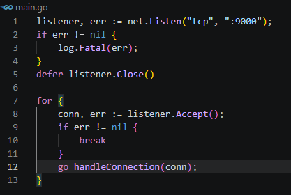
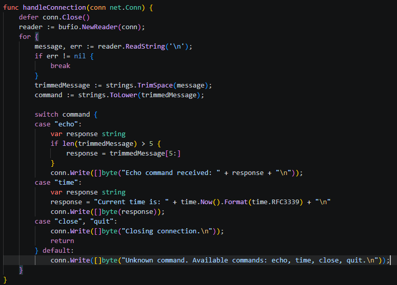
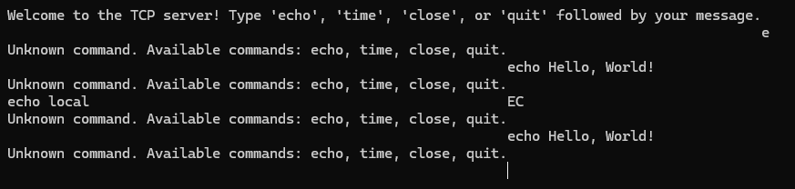
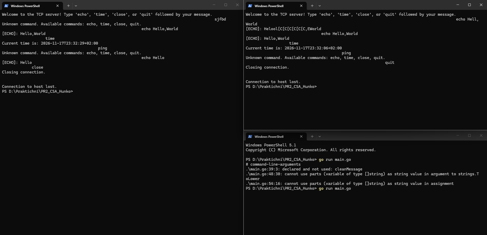
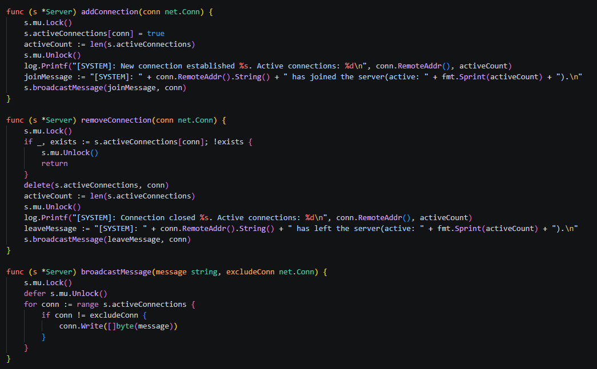
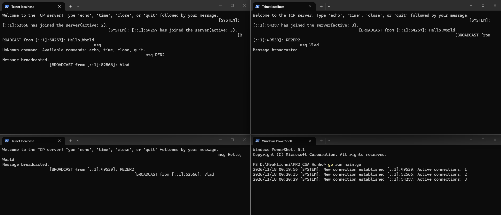
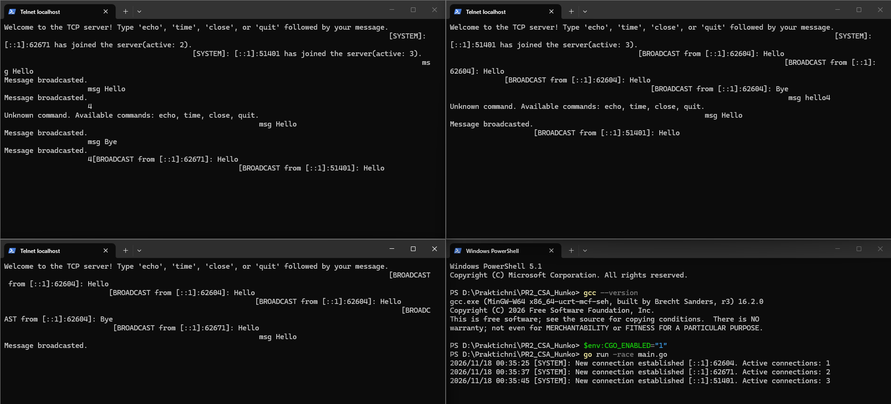

# Практична робота № 2

## Сокетне програмування та обмін повідомленнями по TCP/UDP

**Виконав:** Гунько В. С. КН-41  
**Виконані рівні:** 1 (базовий) та 2 (конкурентний)

---

## 1. Опис проєкту

Проєкт — консольний багатокористувацький **TCP-сервер** на мові Go, написаний лише зі стандартної бібліотеки (`net`, `bufio`, `strings`, `sync`, `time`, `log`, `fmt`). Сервер слухає порт `9000`, приймає кілька клієнтів одночасно та взаємодіє з ними через простий текстовий протокол, де межею повідомлення є символ нового рядка `\n`.

### Реалізовано

**Рівень 1 — Багатопотоковий TCP-сервер команд**

- TCP-слухач на порту `:9000` (`net.Listen`), цикл `Accept()`, для кожного клієнта — окрема горутина (`go srv.handleConnection(conn)`).
- Построкове читання через `bufio.NewReader(conn)` та `ReadString('\n')`.
- Очищення рядка від керувальних символів і пробілів (`strings.Map`, `strings.TrimSpace`), розбір на команду та аргумент (`strings.SplitN`). Назва команди нечутлива до регістру.
- Команди:

| Команда | Дія |
|---|---|
| `ECHO <текст>` | повертає текст у вигляді `[ECHO]: <текст>` |
| `TIME` | повертає поточний час сервера у форматі `time.RFC3339` |
| `CLOSE` / `QUIT` | надсилає `Closing connection.` і закриває з'єднання |
| будь-що інше | повідомлення про помилку зі списком доступних команд |

**Рівень 2 — Потокобезпечна реєстрація та Broadcast**

- Структура `Server` з `map[net.Conn]bool` активних підключень, захищеною `sync.Mutex`.
- `addConnection` — реєструє клієнта, пише в лог системне повідомлення та сповіщає решту клієнтів про приєднання (із кількістю активних підключень).
- `removeConnection` — викликається через `defer`, гарантовано видаляє клієнта з колекції, пише в лог та сповіщає решту про вихід. Повторне видалення безпечне (перевірка `exists`).
- Нова команда `BROADCAST <текст>` / `MSG <текст>` — розсилає повідомлення **всім іншим** клієнтам у форматі `[BROADCAST from <адреса>]: <текст>`, а відправнику повертає `Message broadcasted.`. Без тексту повертається підказка `Usage: broadcast <message>`.
- Обхід колекції та запис у з'єднання виконуються під захистом мʼютекса. Сервер перевірено детектором гонитви (`go run -race`).

### Структура проєкту

```
PR2_CSA_Hunko/
├── main.go          # вихідний код сервера
├── go.mod           # Go-модуль
├── README.md        # цей звіт
└── screenshots/     # скриншоти, використані у звіті
```

### Ключові фрагменти коду

Структура сервера та головний цикл:

```go
type Server struct {
	mu                sync.Mutex
	activeConnections map[net.Conn]bool
}

func main() {
	listener, err := net.Listen("tcp", ":9000")
	if err != nil {
		log.Fatal(err)
	}
	defer listener.Close()

	srv := &Server{activeConnections: make(map[net.Conn]bool)}

	for {
		conn, err := listener.Accept()
		if err != nil {
			break
		}
		go srv.handleConnection(conn) // окрема горутина на клієнта
	}
}
```

Широкомовна розсилка (усім, крім відправника):

```go
func (s *Server) broadcastMessage(message string, excludeConn net.Conn) {
	s.mu.Lock()
	defer s.mu.Unlock()
	for conn := range s.activeConnections {
		if conn != excludeConn {
			conn.Write([]byte(message))
		}
	}
}
```

Розбір команди в обробнику з'єднання:

```go
trimmedMessage := strings.TrimSpace(cleanMessage)
parts := strings.SplitN(trimmedMessage, " ", 2)
command := strings.ToLower(parts[0])

switch command {
case "echo": ...
case "time": ...
case "broadcast", "msg": ...
case "close", "quit": ...
default: ...
}
```

---

## 2. Інструкція запуску

### Вимоги

- Go SDK 1.22 або новіший (`go version`).
- Клієнт для тестування: `telnet`, `nc` (netcat) або Ncat.
- Для запуску з детектором гонитви (`-race`) на Windows потрібні C-компілятор (наприклад, MinGW-w64 `gcc`) та увімкнений CGO.

### Запуск сервера

З кореня проєкту:

```powershell
go run main.go
```

Сервер слухає TCP-порт `9000`. У консолі сервера з'являються повідомлення про підключення та відключення клієнтів.

### Запуск із детектором гонитви (Windows PowerShell)

```powershell
$env:CGO_ENABLED="1"
go run -race main.go
```

Для Linux/macOS: `go run -race main.go`.

### Підключення клієнтів

У окремих терміналах (бажано 2–3):

```sh
telnet localhost 9000
# або
nc localhost 9000
```

### Приклад сеансу

```
Welcome to the TCP server! Type 'echo', 'time', 'close', or 'quit' followed by your message.
echo Hello,World
[ECHO]: Hello,World
time
Current time is: 2026-11-17T23:32:29+02:00
ping
Unknown command. Available commands: echo, time, close, quit.
msg Hello
Message broadcasted.
quit
Closing connection.
```

---

## 3. Скриншоти роботи програми

### Рівень 1. Базовий TCP-сервер команд

**Створення TCP-слухача та цикл прийняття з'єднань** (`net.Listen`, `Accept`, `go handleConnection`):



**Перша версія обробника з'єднання** (`bufio.Reader`, `ReadString('\n')`, `switch` за командами):



**Перше тестування.** На цьому етапі виявлено помилку: команда порівнювалась з усім рядком цілком, тому `echo Hello, World!` повертало `Unknown command`. Це було виправлено розбором рядка на команду та аргумент (`strings.SplitN`):



**Виправлена версія, два незалежні клієнти одночасно.** Працюють `echo`, `time`, `quit`/`close` та відповідь на невідому команду (`ping`). У нижньому вікні видно помилки компіляції проміжної версії (`declared and not used`, `cannot use parts ... as string value`), після виправлення яких сервер успішно запустився:



### Рівень 2. Реєстрація клієнтів та Broadcast

**Менеджер активних підключень** — `addConnection`, `removeConnection`, `broadcastMessage` з використанням `sync.Mutex`:



**Тестування обміну повідомленнями між трьома клієнтами.** Три вікна `telnet` та консоль сервера, у якій для кожного підключення виводиться системне сповіщення з кількістю активних клієнтів. Клієнти отримують сповіщення про приєднання інших (`[SYSTEM]: ... has joined the server(active: N)`), а команда `msg` розсилає повідомлення всім іншим учасникам (`[BROADCAST from ...]`):



**Запуск із детектором гонитви (`go run -race main.go`).** Сервер запущено з прапорцем `-race` (`gcc` встановлено, `CGO_ENABLED=1`), три клієнти підключені, виконується розсилка повідомлень. У консолі сервера є лише системні повідомлення про підключення, **попереджень `DATA RACE` немає**:



---

## 4. Висновки

У роботі реалізовано багатопотоковий TCP-сервер на Go за моделлю «горутина на кожне з'єднання». Розроблено текстовий протокол із розділювачем `\n` та команди `ECHO`, `TIME`, `CLOSE`/`QUIT`, `BROADCAST`/`MSG`. Колекцію активних клієнтів захищено `sync.Mutex`, реєстрацію та видалення клієнтів реалізовано через `defer`, а розсилка повідомлень і системних сповіщень працює між кількома клієнтами одночасно. Перевірка з `go run -race` не виявила станів гонитви.

Рівень 3 (UDP-телеметрія та Graceful Shutdown) у цій роботі не виконувався.

---

## 5. Відповіді на контрольні питання (рівні 1–2)

1. **TCP vs UDP.** TCP — потоковий, з встановленням з'єднання (`net.Listen` + `Accept` → `net.Conn`), гарантує порядок і доставку. UDP — датаграмний, без з'єднання (`net.ListenPacket` → `PacketConn`, `ReadFrom`/`WriteTo`), кожен пакет незалежний і без гарантій доставки.
2. **Межі повідомлень у TCP.** TCP передає безперервний потік байтів, тому одне `Write` не обовʼязково дорівнює одному `Read`. На прикладному рівні межі задають розділювачем (у цій роботі `\n`) або префіксом довжини.
3. **Горутина на з'єднання.** Горутини легковажні (малий стек, що зростає за потреби), їх планує рантайм Go, а блокуючі виклики мережевого вводу-виводу не блокують потоки ОС. Тому код пишеться як простий послідовний, а масштабується на тисячі клієнтів.
4. **Навіщо `sync.Mutex`.** Кілька горутин одночасно змінюють і обходять `map` підключень. Без блокування одночасний запис і читання `map` дає гонитву даних і може призвести до паніки `concurrent map read and map write`.
7. **Клієнти на інших мовах.** Так: сервер використовує звичайний текстовий протокол поверх TCP, тому будь-який клієнт (C#, Java, мобільний, web), що дотримується формату команд із `\n`, зможе з ним працювати.
